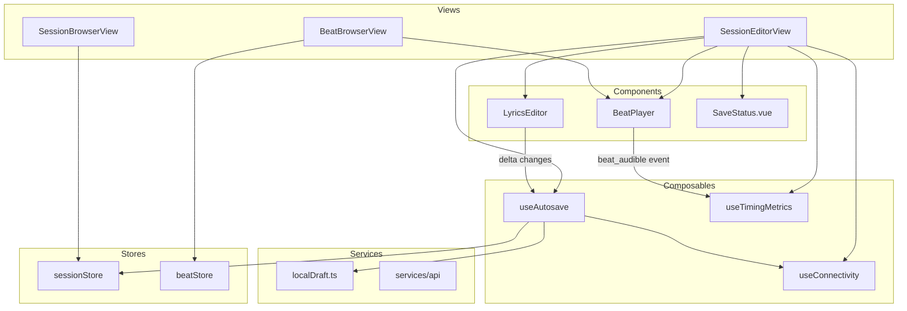
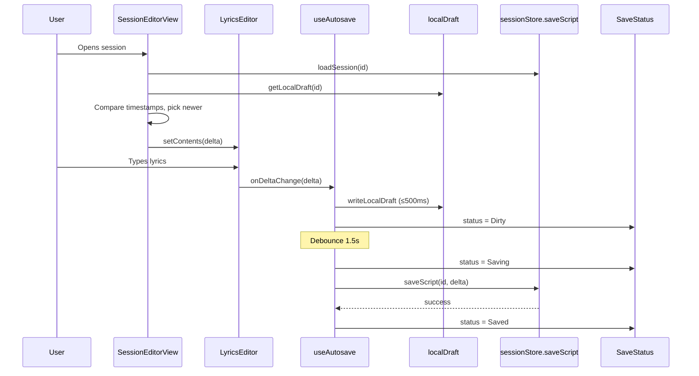
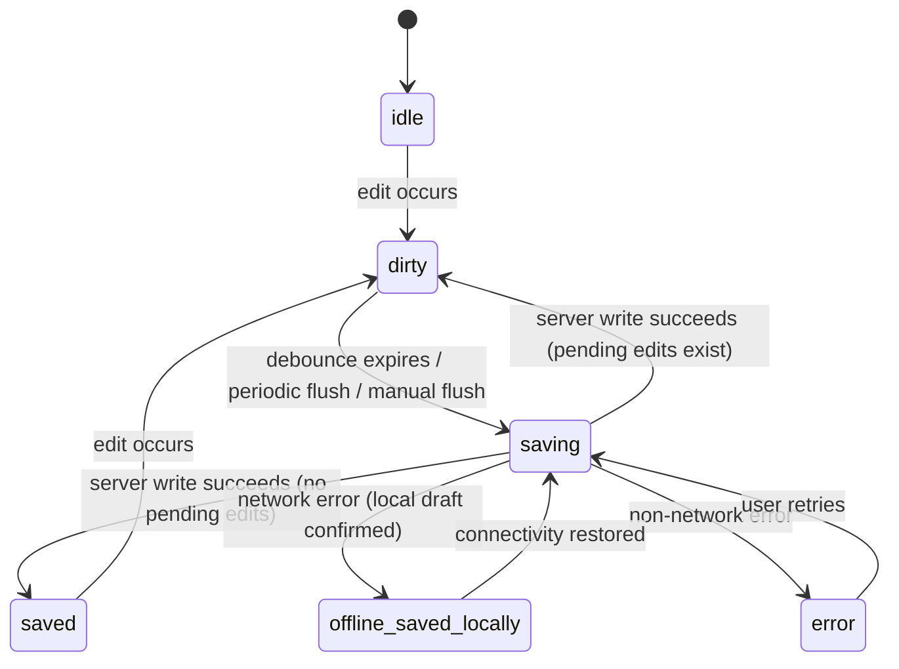

# Design Document: Creative Core Loop

## Overview

This design specifies the vertical-slice MVP for Fluxury's creative core loop: the end-to-end flow from opening the app, selecting or resuming a beat-session, writing lyrics in a Quill editor, autosaving reliably, and resuming with zero data loss after any interruption.

The implementation introduces three new subsystems — an **Autosave_Engine** composable, a **Local_Draft** persistence layer, and a **Timing Metrics** composable — while refactoring the existing `SessionEditorView` away from its naive `setInterval` save into a deterministic state-machine-driven architecture.

**Design principles:**
- State machines are the single source of truth for lifecycle and save status.
- Local persistence (IndexedDB) is the write-ahead log; server writes are eventual confirmation.
- The BeatPlayer is never disrupted by save operations.
- Every transition is auditable — invalid transitions are logged, never silently swallowed.

## Architecture



### Component Interaction Flow



## Components and Interfaces

### 1. `useAutosave` Composable (`src/composables/useAutosave.ts`)

The core save lifecycle composable that replaces the existing `setInterval` approach.

```typescript
interface UseAutosaveOptions {
  sessionId: Ref<string>
  delta: Ref<QuillDelta | null>
  saveFn: (id: string, delta: QuillDelta) => Promise<string | null>
  debounceMs?: number       // default: 1500
  periodicFlushMs?: number  // default: 15000
  localWriteMs?: number     // default: 500
}

interface UseAutosaveReturn {
  saveStatus: Ref<SaveStatus>
  lastSavedAt: Ref<number | null>        // epoch ms of last successful server save
  lastLocalSaveAt: Ref<number | null>    // epoch ms of last local draft write
  flush: () => Promise<void>             // force immediate server write
  destroy: () => void                    // cleanup all timers/listeners
}

type SaveStatus =
  | 'idle'
  | 'dirty'
  | 'saving'
  | 'saved'
  | 'offline_saved_locally'
  | 'error'
```

**Behavioral contract:**
- On delta change → write to Local_Draft within 500ms, set status to `dirty`, reset debounce timer to 1.5s.
- On debounce expiry → attempt server write.
- Every 15s while dirty → force server write regardless of debounce.
- On blur / route-change / beforeunload → flush immediately.
- On server write success → set status to `saved`, record `lastSavedAt`.
- On network error → confirm local draft written, set status to `offline_saved_locally`.
- On non-network error → set status to `error`.
- On connectivity restored while `offline_saved_locally` → retry server write.

**Save Status State Machine:**



### 2. `localDraft` Service (`src/services/localDraft.ts`)

```typescript
interface LocalDraft {
  sessionId: string
  delta: QuillDelta            // Quill Delta JSON
  editTimestamp: number        // epoch ms — used for Last_Write_Wins comparison
  cursorPosition: number       // character offset
  beatPlaybackPosition: number // seconds into the beat
  beatVolume: number           // 0–1
  beatLooping: boolean
}

interface LocalDraftService {
  get(sessionId: string): Promise<LocalDraft | null>
  set(draft: LocalDraft): Promise<void>
  delete(sessionId: string): Promise<void>
  isAvailable(): boolean       // true if IndexedDB works, false = localStorage fallback
}
```

**Storage strategy:**
- Primary: IndexedDB via `idb-keyval` (single object store `fluxury-drafts`).
- Fallback: `localStorage` with key pattern `fluxury-draft-{sessionId}` and JSON serialization.
- Detection: attempt to open an IndexedDB database on init. If it throws (incognito Safari, storage quota), log a `degraded-storage` warning and fall back.

### 3. `useConnectivity` Composable (`src/composables/useConnectivity.ts`)

```typescript
interface UseConnectivityReturn {
  isOnline: Ref<boolean>
  onReconnect: (callback: () => void) => void
  offReconnect: (callback: () => void) => void
}
```

**Detection strategy:**
- Seed from `navigator.onLine`.
- Listen to `window` `online`/`offline` events.
- On any API 4xx/5xx response with a network error signature (no response body, timeout), set `isOnline = false`.
- On `online` event or successful API response, set `isOnline = true` and fire `onReconnect` callbacks.

### 4. Session Lifecycle State Machine (inside `SessionEditorView`)

```typescript
type SessionLifecycleState =
  | 'idle'
  | 'loading'
  | 'ready'
  | 'editing'
  | 'saving'
  | 'saved'
  | 'error'

// Valid transitions (source → target)
const VALID_TRANSITIONS: Record<SessionLifecycleState, SessionLifecycleState[]> = {
  idle: ['loading'],
  loading: ['ready', 'error'],
  ready: ['editing'],
  editing: ['saving'],
  saving: ['saved', 'error', 'editing'],  // 'editing' if new edits during save
  saved: ['editing'],
  error: ['loading'],  // retry
}
```

The transition function logs violations and refuses invalid state changes (Req 3.9, 3.10).

### 5. `SaveStatus.vue` Component (`src/components/SaveStatus.vue`)

```typescript
// Props
interface SaveStatusProps {
  status: SaveStatus
  lastSavedAt: number | null
  onRetry: () => void
}
```

**Label rendering logic:**
| Status | Label |
|--------|-------|
| `idle` | "Idle" |
| `dirty` | (no label change — keeps previous "Saved · Xs ago" or "Idle") |
| `saving` | "Saving…" |
| `saved` | "Saved · just now" → "Saved · 30 seconds ago" → "Saved · 1 minute ago" etc. |
| `offline_saved_locally` | "Offline — saved locally" |
| `error` | "Save failed" + retry button |

A 30-second `setInterval` updates the elapsed-time display while status is `saved`.

### 6. `useTimingMetrics` Composable (`src/composables/useTimingMetrics.ts`)

```typescript
interface TimingMetrics {
  appLoadStart: number | null
  beatAudible: number | null
  editorFocused: number | null
  firstSaveSuccess: number | null
  timeToFirstLyric: number          // computed: firstSaveSuccess - appLoadStart, or 0
}

interface UseTimingMetricsReturn {
  metrics: Readonly<Ref<TimingMetrics>>
  recordAppLoadStart: () => void
  recordBeatAudible: () => void
  recordEditorFocused: () => void
  recordFirstSaveSuccess: () => void
}
```

All timestamps use `performance.now()` anchored to `performance.timeOrigin`.
Exposed via `window.__fluxury_metrics` for debugging. No third-party transmission.

### 7. BeatPlayer Enhancements

The existing `BeatPlayer.vue` gains:
- A new `emit('beat-audible')` event fired on first `onplay` callback per session.
- Accepts a `initialPosition` prop (seconds) for resume — seeks on mount, stays paused.
- Accepts `initialVolume` and `initialLoop` props for state restoration.
- Space-key toggle when LyricsEditor does not have focus (handled in `SessionEditorView` via `keydown` listener).
- Emits `update:playbackState` with `{ position, volume, looping }` that `useAutosave` persists on each save.

## Data Models

### Session (Server-Stored)

The existing `GetSessionResponseContent` is extended logically (the API types remain stable; the `script` field holds the Quill Delta URL or inline data):

```typescript
// Stored as part of the session on the server:
interface SessionPlaybackState {
  beatPlaybackPosition: number  // seconds
  beatVolume: number            // 0–1
  beatLooping: boolean
  cursorPosition: number        // character offset in delta
}
```

This is persisted inside the `script` payload (which is already JSON) or as a separate metadata field on `UpdateSessionRequestContent`. For the MVP, we embed it in the script JSON blob:

```typescript
interface PersistedSessionScript {
  delta: QuillDelta
  playbackState: SessionPlaybackState
  editTimestamp: number  // epoch ms
}
```

### Local Draft (IndexedDB)

```typescript
// Key: sessionId
// Value:
interface LocalDraftRecord {
  sessionId: string
  delta: QuillDelta
  editTimestamp: number          // epoch ms — Last_Write_Wins comparison key
  cursorPosition: number
  beatPlaybackPosition: number
  beatVolume: number
  beatLooping: boolean
}
```

### Quill Delta

Quill's native format — an array of ops:
```typescript
interface QuillDelta {
  ops: Array<{ insert?: string | object; delete?: number; retain?: number; attributes?: Record<string, unknown> }>
}
```

No custom serialization — we persist Quill's `getContents()` output directly.


## Correctness Properties

*A property is a characteristic or behavior that should hold true across all valid executions of a system — essentially, a formal statement about what the system should do. Properties serve as the bridge between human-readable specifications and machine-verifiable correctness guarantees.*

### Property 1: Session ordering is by most-recently-edited

*For any* list of sessions with distinct `modified` timestamps, the Session_Browser's display order SHALL be equivalent to sorting by `modified` descending.

**Validates: Requirements 1.1**

### Property 2: Beat preview switching stops old and starts new

*For any* pair of distinct beats (A, B) where A is currently previewing, activating preview on B SHALL result in A being stopped and B being in playback state.

**Validates: Requirements 2.3**

### Property 3: BeatPlayer state preserved across navigation

*For any* BeatPlayer state (position, volume, looping, playing/paused) at the moment of navigation from Beat_Browser to Session_Editor, the BeatPlayer state after navigation completes SHALL equal the state before navigation.

**Validates: Requirements 2.6**

### Property 4: Session lifecycle state machine correctness

*For any* sequence of events applied to the Session_Editor starting from `idle`, the resulting state SHALL always be exactly one value from { idle, loading, ready, editing, saving, saved, error }, and every transition SHALL be a member of the valid transition set defined in Requirement 3.9. Any invalid transition attempt SHALL be rejected without changing state.

**Validates: Requirements 3.1, 3.9, 3.10**

### Property 5: Save_Status state machine correctness

*For any* sequence of events applied to the Autosave_Engine starting from `idle`, the resulting Save_Status SHALL always be exactly one value from { idle, dirty, saving, saved, offline_saved_locally, error }, and every transition SHALL follow the rules defined in Requirement 7.3. The status SHALL never transition from `saved` to `idle` without an intervening edit event.

**Validates: Requirements 7.1, 7.3, 7.4**

### Property 6: Debounced save fires 1.5s after last edit

*For any* sequence of edits with the last edit at time T, and no further edits occurring between T and T+1.5s, a server write SHALL be initiated at time T+1.5s (±50ms tolerance for timer precision).

**Validates: Requirements 5.1**

### Property 7: Periodic flush within 15s

*For any* session in the Editing state where the most recent server write was at time T, if unsaved edits exist and connectivity is available, a server write SHALL occur before time T+15s.

**Validates: Requirements 5.2**

### Property 8: Local draft written within 500ms of every edit

*For any* edit accepted by the Lyrics_Editor at time T, the Local_Draft store SHALL contain the resulting Quill_Delta by time T+500ms, regardless of connectivity.

**Validates: Requirements 6.1, 9.1**

### Property 9: Server write within 17s of edit (when online)

*For any* edit accepted by the Lyrics_Editor at time T while connectivity is available, a server write containing that edit's delta SHALL complete by time T+17s.

**Validates: Requirements 9.2**

### Property 10: Last_Write_Wins — newer timestamp delta selected on resume

*For any* pair of (server delta with timestamp Ts, local draft delta with timestamp Tl), the Session_Editor on resume SHALL select the delta with max(Ts, Tl). If timestamps are equal, server delta takes precedence.

**Validates: Requirements 9.3, 10.1**

### Property 11: Autosave idempotency

*For any* valid Quill_Delta D, calling `saveScript(sessionId, D)` twice in succession SHALL produce the same server-stored session content as calling it once.

**Validates: Requirements 9.4**

### Property 12: Zero-data-loss round-trip

*For any* sequence of edits [e1, e2, …, en] applied to a session followed by a simulated reload, the restored Quill_Delta SHALL equal the delta produced by the last edit that was committed (written to either Local_Draft or server) before the reload.

**Validates: Requirements 9.5**

### Property 13: Resume determinism

*For any* persisted session state S (including delta, cursor position, beat ID, playback position, volume, looping), resuming from S SHALL always produce the same editor state: same delta content, same cursor position, same beat loaded, same initial playback position.

**Validates: Requirements 10.5**

### Property 14: Time-to-First-Lyric computation correctness

*For any* pair of timestamps (app_load_start, first_save_success) where first_save_success > app_load_start > 0, TTFL SHALL equal first_save_success − app_load_start. For all other cases (null values, first_save_success ≤ app_load_start), TTFL SHALL equal 0.

**Validates: Requirements 12.5, 12.6, 12.7**

## Error Handling

### Network Errors (Autosave)

| Condition | Response |
|-----------|----------|
| Server write fails with no response / timeout | Confirm local draft written → set `offline_saved_locally` → queue retry on reconnect |
| Server write fails with HTTP 5xx | Set `error` → show "Save failed" + retry button |
| Server write fails with HTTP 4xx (non-auth) | Set `error` → show "Save failed" + retry button |
| Server write fails with HTTP 401 | Redirect to login (handled by existing auth interceptor) |

### Local Storage Errors

| Condition | Response |
|-----------|----------|
| IndexedDB open fails | Fall back to localStorage → log `degraded-storage` warning |
| localStorage quota exceeded | Evict oldest draft (by editTimestamp) for a different session → retry write |
| Both IndexedDB and localStorage fail | Log `storage-unavailable` error → continue with server-only saves → show persistent warning |

### Session Load Errors

| Condition | Response |
|-----------|----------|
| Server fetch fails (network) | Check local draft exists → if yes, load from local draft with offline indicator. If no, show error + retry. |
| Server fetch fails (404) | Show "Session not found" → navigate back to Session_Browser |
| Server fetch fails (5xx) | Show error state with retry affordance |

### BeatPlayer Errors

| Condition | Response |
|-----------|----------|
| Audio format unsupported | Show "Unable to play this beat" message in BeatPlayer area |
| Howler volume/audio backend unavailable | Refuse to load → show unsupported-environment message (Req 8.3) |
| Seek fails | Log warning → reset to last known good position |

### beforeunload Edge Cases

| Condition | Response |
|-----------|----------|
| beforeunload fires with unsaved edits | Synchronous write to Local_Draft (best-effort, may be truncated on mobile Safari) |
| Page reloads within 1s of beforeunload | On next open: server fetch first (Req 5.6). Use local draft only if server fetch fails. |

### State Machine Violations

| Condition | Response |
|-----------|----------|
| Invalid transition attempted | Log `state-machine-violation` with current state + attempted event → leave state unchanged |
| State value corrupted (unexpected string) | Reset to `idle` → log `state-corruption-recovery` → force reload session |

## Testing Strategy

### Test Framework Stack

- **Unit tests**: Vitest (already configured in the project)
- **Property-based tests**: `fast-check` (to be added as dev dependency)
- **Component tests**: `@vue/test-utils` + Vitest (already configured)
- **E2E tests**: Playwright (already configured)
- **Mocking**: Vitest's built-in mock facilities, `fake-timers` for time-dependent tests

### Property-Based Testing Configuration

Each property test runs a minimum of **100 iterations** with `fast-check`'s default shrinking.

```typescript
// Example test structure
import fc from 'fast-check'
import { describe, it, expect } from 'vitest'

describe('Autosave_Engine properties', () => {
  it('Property 8: local draft written within 500ms', () => {
    fc.assert(
      fc.property(
        fc.array(arbitraryEdit(), { minLength: 1, maxLength: 50 }),
        (edits) => {
          // ... test body
        }
      ),
      { numRuns: 100 }
    )
  })
})
```

Tag format for every property test:
```
// Feature: creative-core-loop, Property {N}: {property_text}
```

### Test Harness Design

**Fake Timers**: All timing-dependent properties (6, 7, 8, 9) use Vitest's `vi.useFakeTimers()` to advance time deterministically. This allows:
- Verifying debounce fires at exactly 1.5s
- Verifying periodic flush at 15s
- Verifying local draft write within 500ms
- No flaky time-dependent tests

**Mock IndexedDB**: Use `fake-indexeddb` package (or a simple in-memory Map) to simulate IndexedDB in unit tests. This allows testing the Local_Draft service without browser APIs.

**Mock sessionStore.saveScript**: Replace with a vi.fn() that:
- Resolves normally (success path)
- Rejects with a network error (offline path)
- Rejects with an HTTP error (error path)
- Tracks call count and arguments for idempotency verification

**Arbitrary Generators (fast-check)**:
- `arbitraryQuillDelta()` — generates valid Quill Delta objects with varying ops (insert text, formatting, multi-line)
- `arbitraryEdit()` — wraps a delta with a timestamp
- `arbitrarySessionState()` — generates full persisted state (delta + cursor + beat state)
- `arbitrarySaveEvent()` — generates events that drive the Save_Status state machine
- `arbitraryLifecycleEvent()` — generates events that drive the Session_Lifecycle state machine

### Unit Test Coverage (Example-Based)

| Area | Tests |
|------|-------|
| Session_Browser | Empty state, sessions list, resume affordance, ordering |
| Beat_Browser | Preview start/stop/switch, "Start new session", "Open session" |
| Session_Editor lifecycle | Each valid transition, error recovery, retry |
| SaveStatus component | All 6 label states, elapsed time formatting, retry button |
| useAutosave | Blur flush, route-change flush, beforeunload, reconnect retry |
| localDraft service | IndexedDB happy path, localStorage fallback, quota handling |
| useTimingMetrics | Each timestamp record, TTFL edge cases, window exposure |
| BeatPlayer | Space toggle, non-user change filtering, resume position |

### Integration Tests

| Scenario | Validates |
|----------|-----------|
| Full edit → autosave → reload → resume cycle | Req 9.5, 10.1–10.5 |
| Edit while offline → reconnect → server sync | Req 6.2–6.5 |
| Multiple rapid edits → single debounced save | Req 5.1 |
| Beat preview in browser → navigate to editor | Req 2.6 |
| First session creation from Beat_Browser | Req 2.4 |

### E2E Tests (Playwright)

| Scenario | Validates |
|----------|-----------|
| Open app → resume last session → type → see "Saved" | Full happy path |
| Open app → browse beats → preview → start session | Beat-to-session flow |
| Type offline → show offline indicator → reconnect → sync | Offline resilience |
| Session_Browser first-paint under 5s | Req 1.4 |

### Dependencies to Add

```json
{
  "devDependencies": {
    "fast-check": "^3.22.0",
    "fake-indexeddb": "^6.0.0"
  }
}
```
