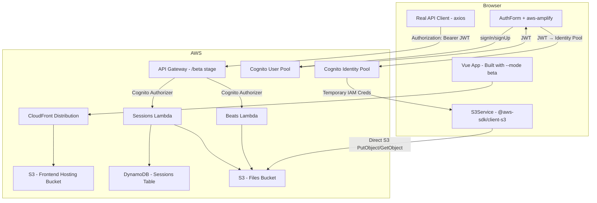

# Design Document: Deploy and Persist

## Overview

This design covers the deployment of FluxuryApp's AWS backend infrastructure and the wiring of the Vue frontend to real persistence services. The outcome is a single-user production system served at `https://juantheengineer.com/fluxury` where sessions, lyrics, and beats persist in DynamoDB and S3.

The deployment is manual (no CI/CD) and optimized for minimal ongoing cost. The developer runs a single deploy script that provisions infrastructure, creates a Cognito user, builds the frontend, and uploads it to S3/CloudFront.

### Key Design Decisions

1. **Modify existing `beta-stack.ts`** rather than creating a new stack — the current code is 90% correct and already provisions the right resources.
2. **Cognito Identity Pool** for direct S3 access from the browser — the `S3Service` already uses the AWS SDK directly, so it needs IAM credentials, not just JWT tokens.
3. **Lambda-generated presigned URLs** for beat audio streaming — avoids exposing S3 bucket publicly while keeping the BeatPlayer simple (standard audio element with a URL).
4. **Single API Gateway** serves both `/sessions` and `/beats` endpoints (already implemented in `beta-stack.ts`).
5. **CloudFront + S3 static hosting** for the frontend — handles SPA routing, HTTPS, and cache headers.

## Architecture



### Request Flow

1. **Login**: AuthForm → `aws-amplify/auth.signIn()` → Cognito User Pool → JWT tokens stored in browser
2. **API Call**: Real API Client → auth-interceptor injects `Authorization: Bearer <idToken>` → API Gateway → Cognito Authorizer validates JWT → Lambda extracts `userId` from claims
3. **S3 Upload/Download**: `fetchAuthSession()` → Identity Pool exchanges JWT for temporary AWS credentials → S3Service uses credentials for direct PutObject/GetObject
4. **Beat Streaming**: Beats Lambda generates presigned S3 URL → BeatPlayer uses presigned URL in `<audio src="...">`

## Components and Interfaces

### CDK Stack Changes (beta-stack.ts)

The existing `beta-stack.ts` needs these modifications:

| Change | Current | Required |
|--------|---------|----------|
| Self-signup | `selfSignUpEnabled: true` | `selfSignUpEnabled: false` |
| Lifecycle rule | 30-day expiration | Conditional via context variable `bucketExpirationDays` |
| Identity Pool | Not present | Add `CfnIdentityPool` + `CfnIdentityPoolRoleAttachment` |
| S3 CORS | Not configured | Add CORS rule for GET from frontend origin |
| Refresh token | Default (30 days) | 7 days |
| CORS origin | Hardcoded `'https://juantheengineer.com'` | Context variable `allowedOrigin` with default |
| Beats Lambda auth | GET is unprotected | Keep GET unprotected (beat list is public) |
| Beats Lambda response | Hardcoded placeholder beats | Query S3 `beats/` prefix for actual files |
| CfnOutput | Missing Identity Pool ID | Add Identity Pool ID output |

### Deploy Script Flow

The enhanced `deploy-beta-code.sh` orchestrates the full deployment:

```
1. Prerequisite checks (node, aws cli, credentials, jq)
2. CDK bootstrap (if needed)
3. CDK synth + deploy → writes cdk-outputs-beta.json
4. Parse outputs (API URL, User Pool ID, Client ID, Bucket, Identity Pool ID)
5. Create Cognito user (admin-create-user + admin-set-user-password)
6. Write .env.beta with real values
7. Build frontend (cd fluxury-app && npm run build -- --mode beta)
8. Deploy frontend to S3 hosting bucket
9. Invalidate CloudFront cache
10. Print verification URLs and next steps
```

### Cognito User Creation (in deploy script)

```bash
# Create user (suppresses welcome email for single-user)
aws cognito-idp admin-create-user \
  --user-pool-id "$USER_POOL_ID" \
  --username "$DEV_EMAIL" \
  --user-attributes Name=email,Value="$DEV_EMAIL" Name=email_verified,Value=true \
  --message-action SUPPRESS

# Set permanent password (bypasses force-change-password state)
aws cognito-idp admin-set-user-password \
  --user-pool-id "$USER_POOL_ID" \
  --username "$DEV_EMAIL" \
  --password "$DEV_PASSWORD" \
  --permanent
```

The developer's email and password are provided either via environment variables (`FLUXURY_DEV_EMAIL`, `FLUXURY_DEV_PASSWORD`) or prompted interactively.

### Beats Lambda Update

The current `beats.ts` returns hardcoded placeholder data. It needs to be updated to:

- **GET /beats**: List actual beat objects stored in DynamoDB (not S3 listing), each containing metadata and a presigned S3 URL for the audio file
- **POST /beats**: Accept beat metadata (name, filename, bpm, key, genre), store metadata in a `beats` partition in the Sessions table (or a new Beats table entry with `id` partition key), and return a presigned upload URL

For simplicity, beat metadata is stored as items in the same Sessions table with a `type: 'beat'` discriminator and `id` prefix of `beat-`.

### S3 Access Pattern

Two access patterns coexist:

1. **Via Lambda (presigned URLs)** — for beat audio streaming. The Beats Lambda generates time-limited presigned GET URLs that the BeatPlayer uses in `<audio>` elements. This avoids CORS complexity for audio streaming.

2. **Direct from browser (Identity Pool)** — for session script upload/download. The existing `S3Service` uses `@aws-sdk/client-s3` directly. It needs Cognito Identity Pool credentials, which `aws-amplify` provides automatically when an Identity Pool is configured.

### Frontend Auth Configuration Update

`auth.ts` needs the Identity Pool added:

```typescript
const awsExports: ResourcesConfig = {
  Auth: {
    Cognito: {
      userPoolId: import.meta.env.VITE_COGNITO_USER_POOL_ID,
      userPoolClientId: import.meta.env.VITE_COGNITO_USER_POOL_CLIENT_ID,
      identityPoolId: import.meta.env.VITE_COGNITO_IDENTITY_POOL_ID,
    }
  }
}
```

### Seed Script

A standalone `scripts/seed-beats.sh` that runs after deployment:

```bash
for beat_file in ../fluxury-app/public/beats/*.wav; do
  filename=$(basename "$beat_file")
  beat_id="beat-${filename%.*}"
  
  # Check if already exists via API
  existing=$(curl -s -H "Authorization: Bearer $TOKEN" "$API_URL/beats" | jq -r ".beats[] | select(.id == \"$beat_id\") | .id")
  
  if [ -n "$existing" ]; then
    echo "Skipping $filename (already exists)"
    continue
  fi
  
  # Upload .wav to S3
  aws s3 cp "$beat_file" "s3://$BUCKET_NAME/beats/$beat_id/audio.wav"
  
  # Register metadata via API
  curl -X POST "$API_URL/beats" \
    -H "Authorization: Bearer $TOKEN" \
    -H "Content-Type: application/json" \
    -d "{\"id\":\"$beat_id\",\"name\":\"$filename\",\"fileName\":\"$filename\"}"
done
```

### CloudFront + S3 Frontend Hosting

Added to the CDK stack:

- **S3 bucket** (private, OAI access only) for frontend static assets
- **CloudFront distribution** with:
  - Default root object: `index.html`
  - Custom error response: 403/404 → `/index.html` (SPA routing)
  - Cache policy: hashed assets (`/assets/*`) get `max-age=31536000, immutable`; `index.html` gets `max-age=300`
  - HTTPS via ACM certificate on `juantheengineer.com`
  - Alternate domain: `juantheengineer.com` with path pattern `/fluxury*`

**Note**: If the developer's domain is already on Squarespace/another host, an alternative is to use a CloudFront distribution on a subdomain (e.g., `app.juantheengineer.com`) or deploy under the default CloudFront domain for beta and CNAME later.

## Data Models

### DynamoDB Sessions Table

| Attribute | Type | Key | Description |
|-----------|------|-----|-------------|
| `id` | String | Partition Key | UUID for the session |
| `userId` | String | Sort Key | Cognito `sub` claim |
| `name` | String | — | Session title |
| `author` | String | — | Artist name |
| `beatUrl` | String | — | Presigned URL or S3 key for beat |
| `artworkUrl` | String | — | S3 key for artwork |
| `script` | String | — | Quill Delta JSON (stringified) |
| `created` | String | GSI Sort Key | ISO timestamp |
| `modified` | String | — | ISO timestamp |
| `ttl` | Number | — | TTL epoch (90 days from creation) |

**GSI (UserIndex)**: `userId` (partition) + `created` (sort) — enables "list my sessions sorted by recency"

### Beat Metadata (stored in same table)

| Attribute | Type | Key | Description |
|-----------|------|-----|-------------|
| `id` | String | Partition Key | `beat-{slug}` |
| `userId` | String | Sort Key | Owner's Cognito sub (or `system` for seeded) |
| `type` | String | — | Discriminator: `'beat'` |
| `name` | String | — | Display name |
| `fileName` | String | — | Original filename |
| `s3Key` | String | — | S3 object key (`beats/{id}/audio.wav`) |
| `bpm` | Number | — | Tempo (optional) |
| `genre` | String | — | Genre tag (optional) |
| `created` | String | — | ISO timestamp |

### Environment Variables (.env.beta)

| Variable | Source | Description |
|----------|--------|-------------|
| `VITE_DEMO_MODE` | Static | `false` |
| `VITE_API_BASE_URL` | CDK Output `APIGatewayURL` | e.g., `https://abc123.execute-api.us-east-1.amazonaws.com/beta` |
| `VITE_BEATS_API_BASE_URL` | Same as above | Same gateway, `/beats` route |
| `VITE_AWS_REGION` | Deploy region | `us-east-1` |
| `VITE_COGNITO_USER_POOL_ID` | CDK Output `UserPoolId` | e.g., `us-east-1_ABC123` |
| `VITE_COGNITO_USER_POOL_CLIENT_ID` | CDK Output `UserPoolClientId` | e.g., `3iu3p4skol...` |
| `VITE_COGNITO_IDENTITY_POOL_ID` | CDK Output `IdentityPoolId` | e.g., `us-east-1:uuid` |
| `VITE_S3_BUCKET_NAME` | CDK Output `S3BucketName` | e.g., `fluxury-beta-files-123456-us-east-1` |

## Correctness Properties

*Property-based testing does not apply to this spec.* This is an infrastructure deployment and integration-wiring feature where:

- The CDK stack is declarative IaC — verified by `cdk synth` producing valid CloudFormation and `cdk deploy` succeeding without rollback
- The deploy script is a sequential side-effect-only shell script — verified by execution and observing outputs
- The frontend wiring connects existing code to real endpoints — verified by end-to-end integration tests

There are no pure functions with universal input/output properties. Testing uses CDK assertions, smoke tests, and integration tests instead.

### Property 1: Session script round-trip preservation

*For any* valid session script JSON object, uploading it to S3 via the Real API Client and then downloading it SHALL produce a JSON object equivalent to the original.

**Validates: Requirements 5.6**

## Error Handling

### Deploy Script Errors

| Error | Detection | Response |
|-------|-----------|----------|
| Missing AWS credentials | `aws sts get-caller-identity` fails | Print "Run `aws configure` or export AWS_ACCESS_KEY_ID" and exit 1 |
| Missing Node.js/jq/aws-cli | `command -v` check | Print install instructions and exit 1 |
| CDK bootstrap needed | CDK error message | Auto-run `cdk bootstrap` |
| CloudFormation rollback | Non-zero exit from `cdk deploy` | Print stack events URL, preserve error log, exit 1 |
| Cognito user already exists | `admin-create-user` returns `UsernameExistsException` | Skip creation, print "User already exists" |
| Frontend build fails | Non-zero exit from `npm run build` | Print error, exit 1 (CDK stack is still deployed) |
| S3 upload fails | Non-zero exit from `aws s3 sync` | Print error, suggest manual upload |

### Runtime Errors (Frontend)

| Error | Detection | Response |
|-------|-----------|----------|
| Expired ID token | 401 from API Gateway | `auth-interceptor` calls `fetchAuthSession({ forceRefresh: true })` and retries once |
| Expired refresh token | 401 after retry | Emit warning, redirect to AuthForm |
| Network offline | axios network error | Preserve local draft, show connectivity warning via `useNotifications` |
| S3 upload fails | SDK error | Retry once, then show "Save failed" notification; local draft preserved |
| CORS error | Browser blocks response | Check API Gateway CORS config; most common cause is missing `allowedOrigin` context |

### Cold Start Mitigation

Lambda cold starts (3-5s) are acceptable for beta single-user use. No provisioned concurrency. The frontend should:
- Show a loading spinner during first API call after login
- Not treat slow responses as errors (axios timeout set to 30s)

## Testing Strategy

### Approach

Since this is infrastructure deployment code, property-based testing is not applicable. The testing strategy uses:

1. **CDK Assertion Tests** — validate the synthesized CloudFormation template contains expected resources, properties, and IAM policies
2. **Smoke Tests** — verify deployment succeeds, endpoints respond, and authentication works
3. **Integration Tests** — end-to-end flow: login → create session → reload → verify persistence
4. **Manual Verification Checklist** — a structured list of checks the developer runs post-deployment

### CDK Assertion Tests (unit-level)

Located in `fluxury-infra/test/`:

- `beta-stack.test.ts` — verifies:
  - Sessions table has pay-per-request billing, correct keys, GSI
  - User Pool has self-signup disabled, SRP auth, 7-day refresh token
  - Identity Pool exists and is linked to User Pool
  - S3 bucket has CORS configured
  - API Gateway CORS includes the configured origin
  - Lambda functions have correct environment variables
  - IAM policies grant Lambdas read/write to table and bucket

### Smoke Tests (post-deploy)

Script: `scripts/verify-deployment.sh`

1. Curl API Gateway health endpoint → expect 200 or 403 (auth required)
2. Attempt Cognito `admin-initiate-auth` → expect tokens
3. Curl `GET /sessions` with token → expect `{ sessions: [] }`
4. Curl CloudFront URL → expect HTML containing `<div id="app">`
5. Check S3 bucket exists and is accessible with Identity Pool creds

### Integration Test (manual checklist)

1. Open deployed URL in browser
2. AuthForm visible → enter credentials → login succeeds
3. Sessions list is empty → create new session
4. Write lyrics → wait for autosave indicator
5. Close tab → reopen URL → session appears with lyrics intact
6. Play a seeded beat → audio streams without error
7. Test on mobile device (different network) → same session visible

### Environment Validation

At app startup, validate required env vars are present:

```typescript
const required = ['VITE_API_BASE_URL', 'VITE_COGNITO_USER_POOL_ID', 
                  'VITE_COGNITO_USER_POOL_CLIENT_ID', 'VITE_S3_BUCKET_NAME', 'VITE_AWS_REGION']
const missing = required.filter(k => !import.meta.env[k])
if (missing.length && import.meta.env.VITE_DEMO_MODE === 'false') {
  throw new Error(`Missing required env vars: ${missing.join(', ')}`)
}
```

## Risks and Mitigations

| Risk | Likelihood | Impact | Mitigation |
|------|-----------|--------|------------|
| Lambda cold starts (3-5s first request) | High | Low (single user) | Accept for beta; add loading state in UI |
| CORS misconfiguration blocks all API calls | Medium | High | Test preflight with `curl -X OPTIONS`; ensure CDK context variable matches deployed domain |
| Cognito token refresh fails silently | Medium | Medium | Auth interceptor retries once, then redirects to login; refresh token is 7 days |
| S3 direct access denied (Identity Pool misconfigured) | Medium | High | Test immediately after deploy; IAM policy must scope to bucket ARN |
| CloudFront serves stale `index.html` after redeploy | Medium | Low | Invalidate `/*` after each frontend upload; set short max-age on HTML |
| DynamoDB TTL deletes sessions unexpectedly | Low | High | Set TTL to 90 days; document that beta data expires; consider removing TTL |
| Beats Lambda returns empty list (seed script not run) | High | Low | Deploy script prints reminder; seed script is idempotent |
| Frontend built without .env.beta (wrong mode) | Medium | High | Deploy script builds with explicit `--mode beta`; env validation at startup throws |
| Domain/CloudFront CNAME conflict with Squarespace | Medium | Medium | Use subdomain (`app.juantheengineer.com`) or CloudFront default domain for beta |
| AWS costs exceed expectations | Low | Low | Pay-per-request DDB, 256MB Lambda, no provisioned concurrency; expected <$5/month at single-user scale |
